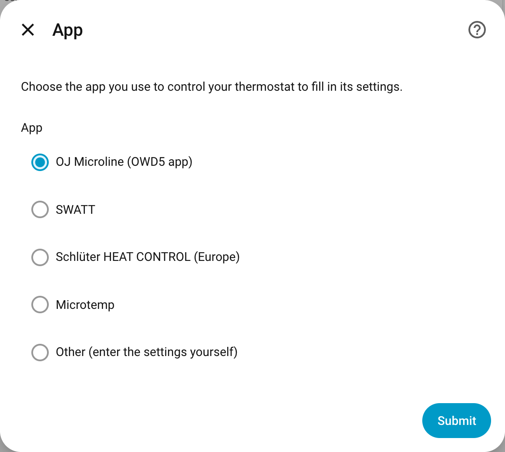

# Apps and login settings

When you add an account, you first choose the thermostat series. For the WD5
and WG4 series you then choose the app you use to control your thermostat,
which fills in its settings, or choose **Other** to enter them yourself.

To change these settings later, for example after changing your password or to
use another host, choose **Reconfigure** in the integration's menu.

## WD5 series

WD5-series thermostats are sold under several brands, each with its own app. The apps share one API key (`f219aab4-9ac0-4343-8422-b72203e2fac9`, used when you leave the field blank); they differ in host and customer ID. Use the username and password of the app.

| App | Host | Customer ID |
| --- | --- | --- |
| OJ Microline (OWD5 app) | (default) | `1` |
| SWATT | (default) | `99` |
| Schlüter HEAT CONTROL (Europe, DITRA-HEAT-E-WiFi and DITRA-HEAT-E-R6) | `owd5-sl003-app.ojelectronics.com` | `3` |
| Microtemp | `owd5-mh015-app.ojelectronics.com` | `111` |

The Schlüter and Microtemp settings were reported by users ([#466](https://github.com/robbinjanssen/home-assistant-ojmicroline-thermostat/issues/466) and the Home Assistant forum: [Schlüter R6](https://community.home-assistant.io/t/schluter-ditra-heat-home-assistant-integration/185275/65), [Microtemp](https://community.home-assistant.io/t/mwd5-wifi-thermostat-oj-electronics-microtemp/445601)); the maintainers have not tested them.

If the login fails, try the customer ID of another app (1, 99 or 3). The customer ID belongs to the app your account was created with, which is not always the number the app shows under thermostat data (the Schlüter app shows 33, for example). Does your app work with other settings? Open an issue with them, so they can be added.

## WG4 series

WG4-series thermostats are also sold under several brands. Their apps differ in host and application code. Use the email address and password of the app.

| App | Host | Application code |
| --- | --- | --- |
| OJ Microline (mythermostat.info) | (default) | `2` |
| Danfoss LX | `lxwifi.danfoss.us` | `4` |
| Schlüter DITRA-HEAT-E-WiFi (North America) | `ditra-heat-e-wifi.schluter.com` | `7` |

The Danfoss and Schlüter settings were reported by users ([#441](https://github.com/robbinjanssen/home-assistant-ojmicroline-thermostat/issues/441), [#469](https://github.com/robbinjanssen/home-assistant-ojmicroline-thermostat/issues/469)); the maintainers have not tested them. With the wrong application code the login succeeds, but the account has no thermostats; the integration then asks you to check the app.

## WG5 series

For a WG5-series thermostat, enter the username and password of the OJ Microline app. Leave **Identity host** blank, unless you use another brand:

| App | Identity host |
| --- | --- |
| OJ Microline | (default) |
| nJoy / WarmlyYours | `identity.njoy.warmlyyours.com` |
