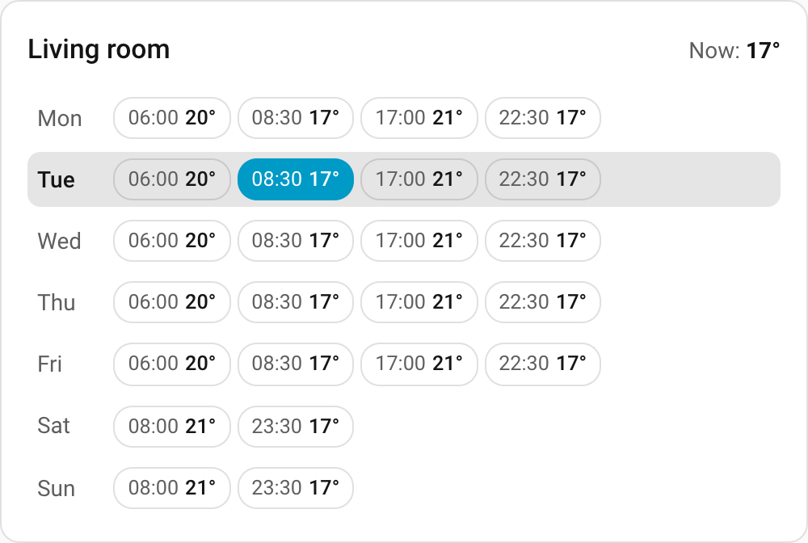
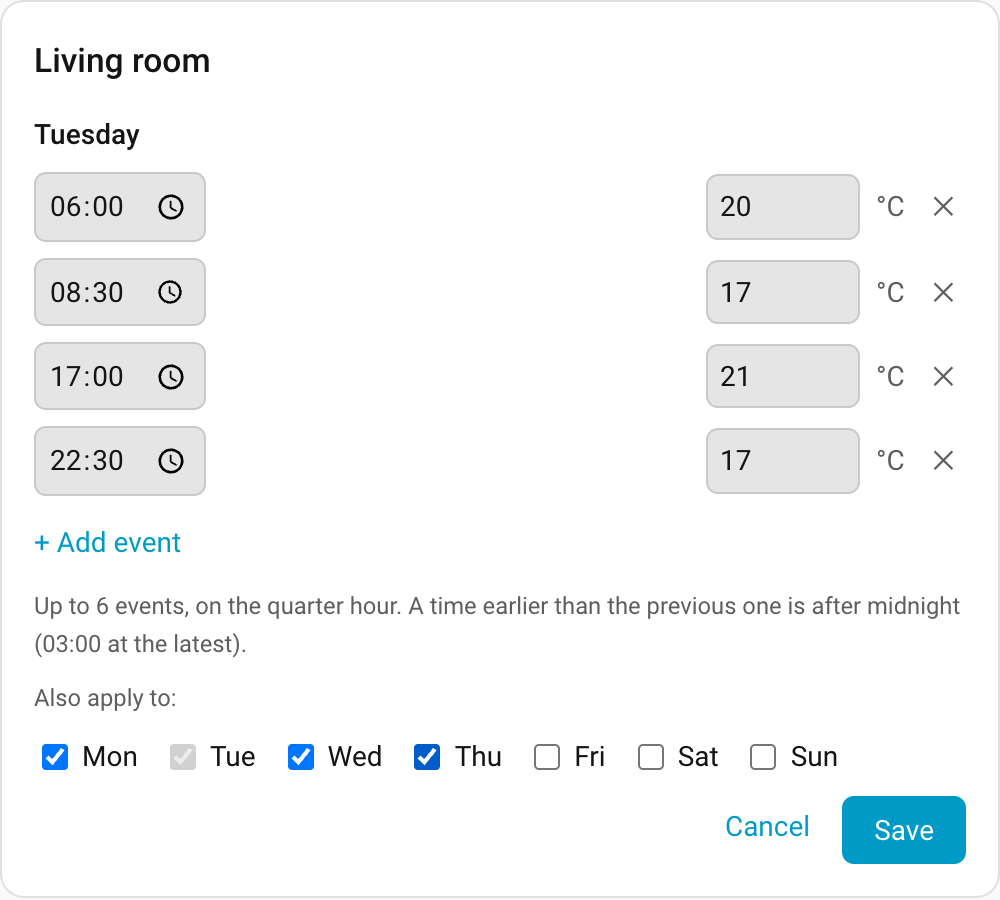

# Schedule and vacation

WD5-series thermostats get a weekly schedule and a vacation. Like in the apps,
these belong to the thermostat's group. They stay available while a thermostat
is offline, because the cloud keeps those settings.

A WG4-series thermostat keeps its own weekly schedule, which the same sensor
and card show; changing it needs the local connection, see
[Weekly schedule (WG4 series)](#weekly-schedule-wg4-series).

## Entities (WD5 series)

| Entity | Description |
| --- | --- |
| `sensor.<name>_schedule` | The temperature the weekly schedule prescribes right now. The attributes list every weekday's events (`time`, `temperature`, and `next_day` for events after midnight). |
| `date.<name>_vacation_begin` | The first day of the vacation. |
| `date.<name>_vacation_end` | The day normal regulation resumes (at 00:00). Moving one date past the other moves the other along. |
| `switch.<name>_vacation` | Enables the vacation period. If it has already started, vacation mode is activated immediately; switching it off returns to schedule or manual mode, whichever was used last. |

## Schedule card

The integration ships a dashboard card that shows the weekly schedule and highlights the event that is active right now.



Tap a day to edit it: change, add or remove events, optionally apply the same events to other days, and save.



It is loaded automatically: edit a dashboard, add a card and pick **OJ Microline schedule**, or use YAML:

```yaml
type: custom:ojmicroline-schedule-card
entity: sensor.living_room_schedule
title: Living room  # optional
climate_entity: climate.living_room  # optional; found via the device otherwise
```

The card shows and takes temperatures in the unit of Home Assistant, Celsius or Fahrenheit, within the limits of the thermostat. An event whose temperature you do not change keeps its exact value.

## Actions

| Action | Description |
| --- | --- |
| `ojmicroline_thermostat.set_schedule` | Set the events of one or more weekdays: up to 6 per day, on the quarter hour, at least 15 minutes apart, 5-40 °C. A time earlier than the previous one is after midnight (03:00 at the latest). The first event must be at 22:00 at the latest. Temperatures are in °C, whatever unit Home Assistant uses. For the WG4 series, see [below](#weekly-schedule-wg4-series). |
| `ojmicroline_thermostat.set_vacation` | Set and enable a vacation from `start_date` until `end_date`. |
| `ojmicroline_thermostat.cancel_vacation` | Disable the vacation. |

```yaml
action: ojmicroline_thermostat.set_schedule
target:
  entity_id: climate.living_room
data:
  days: [monday, tuesday, wednesday, thursday, friday]
  events:
    - time: "06:00"
      temperature: 21
    - time: "08:30"
      temperature: 17
    - time: "17:00"
      temperature: 21
    - time: "22:30"
      temperature: 17
```

## Weekly schedule (WG4 series)

A WG4-series thermostat keeps its own weekly schedule, which `sensor.<name>_schedule` shows like the one of a WD5 group, and which the [schedule card](#schedule-card) shows too. It is read from the cloud, or from the thermostat itself on the [local connection](local-connection.md).

Changing the schedule, with the card or with `ojmicroline_thermostat.set_schedule`, only works through the local connection, with the relay or local only, while the thermostat is connected to Home Assistant. Its rules differ from those of a WD5 group:

- Up to 6 events per day, on the quarter hour, in order within the day. There are no events after midnight: the last temperature of a day lasts until the first event of the next day.
- The temperatures have to be within the limits of the thermostat.
- Mode, setpoints and the other days stay as they are.
- The thermostat does not tell whether it kept a new schedule. Home Assistant makes it connect again and compares what it reports then, so a save takes up to about a minute and a half, and the thermostat shows offline for a moment. If the thermostat does not report back in time, the action fails with a message that the schedule was not confirmed: it may have been kept, so check before trying again.

This follows what one user saw on one thermostat. Whether the app shows a schedule changed this way, with the relay, has not been tried yet; please report how it goes.
